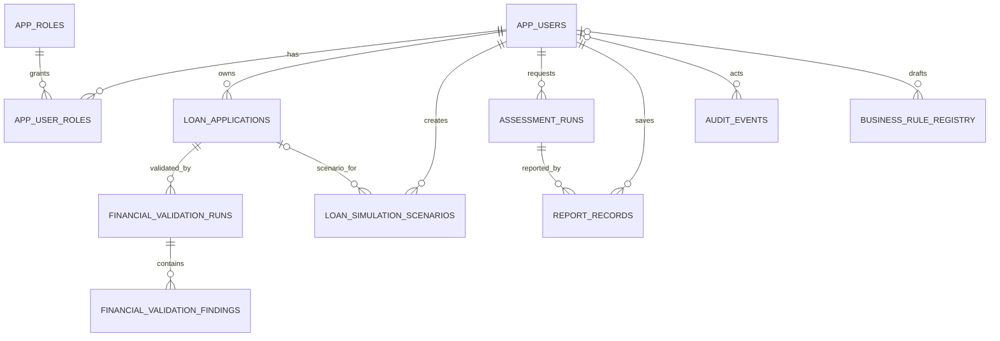

# M08.2 — Logical ERD (proposal)

## Important external boundaries

- CORE4 is deliberately outside this ERD. `assessment_runs.sk_id_curr` is a reference to the read-only snapshot, not a foreign key to a copied table.
- H16 pipeline, 169 predictor matrix, split manifest, TARGET and threshold policy are outside this ERD.
- Business rules are stored as governance metadata only and cannot execute under the current schema proposal.

## Entity roles

- `app_users`, `app_roles`, `app_user_roles`: verified identity and authorization mapping.
- `loan_applications`: owner-scoped user-entered applications.
- `financial_validation_runs`, `financial_validation_findings`: technical input-quality outcomes only.
- `loan_simulation_scenarios`: hypothetical W04 scenario assumptions/results.
- `assessment_runs`: immutable H18 support-signal snapshots.
- `report_records`: explicitly saved W06 report snapshots.
- `audit_events`: append-only activity trail.
- `business_rule_registry`: versioned but non-executable rule catalogue.
- `schema_migrations`: applied schema version/checksum ledger.
